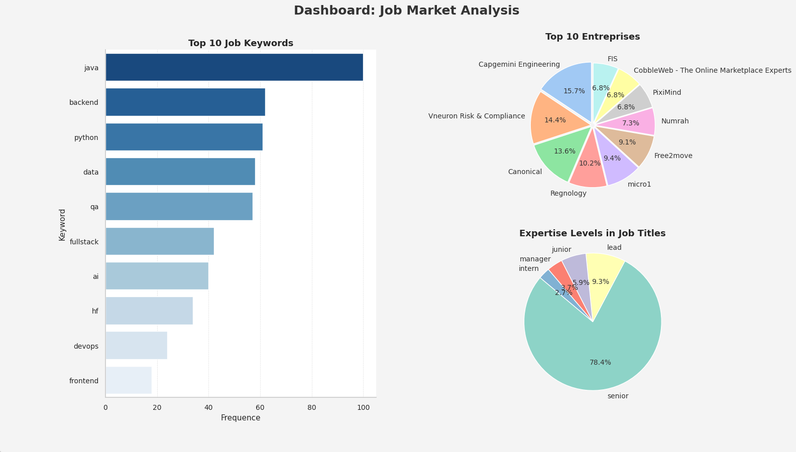

# Development of a web scraping robot to identify in-demand professions in the market

> **Academic project (P2M).** This repository is the deliverable of a university project, developed for educational and research purposes only.

## Context and objectives

Nowadays, the professions in demand, particularly on an international scale, are highly varied and diverse, presenting individuals with a multitude of paths during their training.

This project develops a tool that collects job listings in order to:
- identify the most in-demand professions
- rank them by priority
- present the required profiles to candidates, so they can tailor their training to market needs

**Data source:** job listings from LinkedIn Jobs, filtered on Tunisia and collected in 2025 across 15 tech professions (Data Scientist, Backend / Frontend / Full-Stack Developer, Software Engineering, Blockchain, Cloud, Cybersecurity, DevOps, Data Engineer, AI, IoT, Embedded Software, Mobile and Web Engineer).

## Pipeline

1. **Step 1 – Data collection.** A Selenium-based robot gathers job postings and stores one CSV per profession with: job title, company name, time posted, location, link.
2. **Step 2 – Analysis** (`Step_2/Job_Market_Analysis.ipynb`):
   1. Merges all CSV files into a single DataFrame.
   2. Translates job titles to English (`translatepy`) so French and English titles are comparable.
   3. Cleans the data: removes unused columns, missing values and normalizes titles.
   4. Extracts seniority levels (senior, lead, junior, intern, manager) and the most frequent technology/profession keywords with `CountVectorizer`.
   5. Builds a dashboard with the top 10 job keywords, the top 10 hiring companies and the seniority distribution.



*Figure 1 – Dashboard of the job market analysis: top 10 job keywords, top 10 hiring companies and seniority levels in job titles.*

## Repository content

```
P2M/
├── Step_1/                     # Data collection (local only, not pushed)
│   ├── Scraping.ipynb          # Collection robot
│   └── Extracted_Jobs/         # One CSV per profession
├── Step_2/
│   ├── Job_Market_Analysis.ipynb  # Cleaning, keyword extraction, dashboard
│   └── output.png              # Resulting dashboard
├── .gitignore
└── README.md
```

## Technologies

Python · Selenium · BeautifulSoup · pandas · NumPy · scikit-learn · matplotlib · seaborn · translatepy

## Installation

```bash
pip install pandas numpy scikit-learn matplotlib seaborn translatepy
```

## Usage

The analysis notebook expects a folder of `;`-separated CSV files with the columns `job_title`, `company_name`, `time_posted`, `location` and `link`. Set `folder_path` in the notebook to that folder, then run all cells.

## Limitations

- Results reflect a single snapshot of one platform and one country, so they may not generalize.
- Keyword extraction is based on job titles only, not on full job descriptions.
- Titles are machine-translated, so a few translations may be imprecise.

## Data usage

The data was collected from LinkedIn in 2025 and is for academic use only, with no redistribution. It is used only for analysis and learning, never for commercial purposes. For this reason, the raw data and the collection code are not published in this repository.